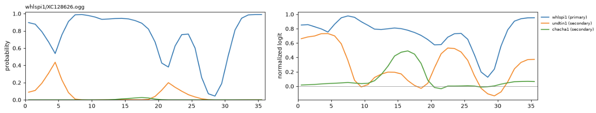
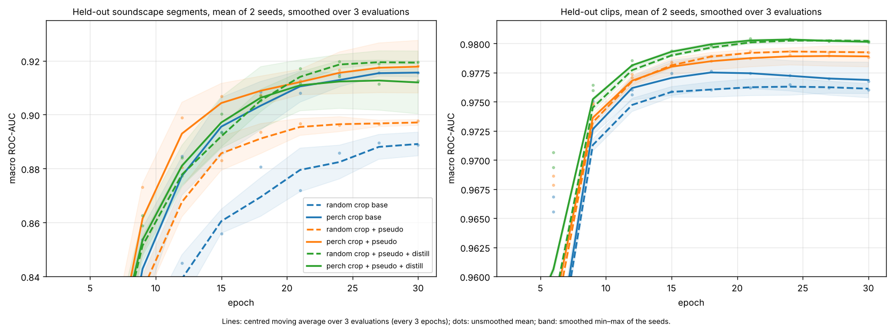
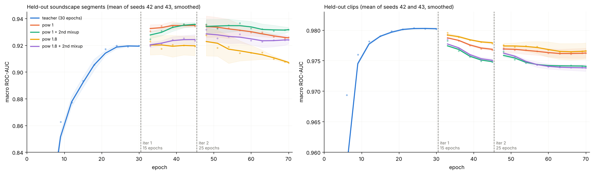

# BirdCLEF+ 2026: a small CNN supervised by Perch v2

[](https://github.com/y284/birdclef-2026/actions/workflows/ci.yml)

**42nd of 4,091 teams, silver medal** (ROC-AUC 0.95 private, 0.96 public), [BirdCLEF+ 2026](https://www.kaggle.com/competitions/birdclef-2026): predict which of 234 species (birds, frogs, mammals, insects, 25 insect sonotypes) call in each 5 s window of field recordings.

The solution uses Google's Perch v2 ([paper](https://arxiv.org/abs/2508.04665), [model](https://www.kaggle.com/models/google/bird-vocalization-classifier/)) as a supervisor for a small CNN, through both of its outputs: its **logits** choose where to crop training clips and label unannotated species; its **embeddings** are a teacher the CNN learns to match.

This repository is a from-scratch re-implementation of the solution's core ideas as a clean, tested pipeline. Every number below comes from runs of this code (EfficientNet-B0, two seeds per experiment, one fixed held-out split) and can be reproduced with the commands shown.

## Pipeline

```bash
pip install -e ".[perch,notebooks]"
export BIRDCLEF_DATA=/path/to/birdclef-2026

python -m birdclef.prepare --workers 8 --delete-src    # OGG → mono 16-bit WAV, 32 kHz
mkdir -p models
wget -O models/perch_v2_no_dft.onnx https://huggingface.co/justinchuby/Perch-onnx/resolve/main/perch_v2_no_dft.onnx
python -c "import glob, shutil, kagglehub; p = kagglehub.model_download('google/bird-vocalization-classifier/tensorFlow2/perch_v2'); shutil.copy(glob.glob(f'{p}/**/labels.csv', recursive=True)[0], 'models/labels.csv')"
python -m birdclef.perch --batch 64                    # Perch embeddings + logits, every 5 s window, 1 s stride
python -m birdclef.postprocess                         # per-second normalized curves, trusted species
python -m birdclef.train --selection random --pseudo --distill 1 --teacher-backend split \
    --mixup 1 --holdout-unscored --epochs 30 --eval-every 3 --max-windows 12 --seeds 42 43 --out outputs/v2

# iteration 1: pseudo-label the unlabelled soundscapes with both seeds, fine-tune each seed from its own checkpoint
python -m birdclef.pseudo --out data/pseudo/iter1 --models \
    outputs/v2/model_tf_efficientnet_b0_random_pseudo_distill_mixup_unscored_split_seed42_best.pt \
    outputs/v2/model_tf_efficientnet_b0_random_pseudo_distill_mixup_unscored_split_seed43_best.pt
A="--selection random --pseudo --distill 1 --teacher-backend split --holdout-unscored --pseudo-dir data/pseudo/iter1
   --drop-path 0.1 --lr 3e-4 --epochs 15 --eval-every 3 --max-windows 12 --workers 4 --seeds 42 43"
T="outputs/v2/model_tf_efficientnet_b0_random_pseudo_distill_mixup_unscored_split_seed{seed}_best.pt"
python -m birdclef.train $A --pseudo-pow 1 --init $T --out outputs/iter1_e15_pow1
python -m birdclef.train $A --pseudo-pow 1 --mixup 1 --init $T --out outputs/iter1_e15_pow1_mix2
python -m birdclef.train $A --pseudo-pow 1.8 --init $T --out outputs/iter1_e15_pow1.8
python -m birdclef.train $A --pseudo-pow 1.8 --mixup 1 --init $T --out outputs/iter1_e15_pow1.8_mix2

# iteration 2: pseudo-labels from the four iteration-1 pow-1 models, fine-tuned from iteration 1 pow 1
python -m birdclef.pseudo --out data/pseudo/iter2 --models outputs/iter1_e15_pow1{,_mix2}/*_best.pt
A="--selection random --pseudo --distill 1 --teacher-backend split --holdout-unscored --pseudo-dir data/pseudo/iter2
   --drop-path 0.2 --lr 3e-4 --epochs 25 --eval-every 3 --max-windows 12 --workers 4 --seeds 42 43"
T="outputs/iter1_e15_pow1/model_tf_efficientnet_b0_random_pseudo_distill_unscored_pl-iter1_split_seed{seed}_best.pt"
python -m birdclef.train $A --pseudo-pow 1 --init $T --out outputs/iter2_e25_pow1
python -m birdclef.train $A --pseudo-pow 1 --mixup 1 --init $T --out outputs/iter2_e25_pow1_mix2
python -m birdclef.train $A --pseudo-pow 1.8 --init $T --out outputs/iter2_e25_pow1.8
python -m birdclef.train $A --pseudo-pow 1.8 --mixup 1 --init $T --out outputs/iter2_e25_pow1.8_mix2

# CPU inference: ONNX / OpenVINO benchmark, then site and hour priors on the ensemble
# the 8 checkpoints of iterations 1 and 2 at pow 1, with and without mix2 (seeds 42 and 43)
ENSEMBLE=$(ls outputs/iter1_e15_pow1{,_mix2}/*_best.pt outputs/iter2_e25_pow1{,_mix2}/*_best.pt)
python -m birdclef.export --threads 4 --models $ENSEMBLE
python -m birdclef.sitehour --models $ENSEMBLE
```

## Method

**Audio.** Every OGG file (training clips and soundscapes) is decoded once to mono 16-bit WAV at 32 kHz (`birdclef.prepare`), so training reads any crop directly instead of decoding the whole file.

**Perch features.** Perch v2 (ONNX) runs on every 5 s window with a 1 s stride. Its logits are kept for the 203 of 234 species it covers (matched by scientific name; not covered: 25 sonotypes, 3 frogs, 2 primates, a caiman) and normalized per species: mean over all windows → 0, 99th percentile over the species' own clips → 1. Unlike softmax, this keeps overlapping species visible. Each second gets the weighted mean of the 5 windows covering it (weights 0.1, 0.3, 0.6, 0.3, 0.1). Species where Perch scores a clip ROC-AUC above 0.9 are *trusted*: 195 of 203.



*One training clip (primary whlspi1, secondaries undtin1 and chacha1), per-second Perch curves. Left: softmax, where the primary species dominates, undtin1 shows only where whlspi1 dips and chacha1 never rises above 0.03. Right: normalized logits, where both secondary species show up where they call; these curves drive the crop selection (`--selection perch`) and the pseudo targets (`--pseudo`).*

**Model.** Log-mel at 32 frames/s → EfficientNet-B0 (time ÷ 32, so one frame per second) → GeM over frequency → per-second logits, attention-pooled into clip logits. Masked cross-entropy, EMA of the weights, bf16/fp16.

**Uses of Perch** (each a flag):

| Flag | What it does |
|---|---|
| `--selection perch` | crop centre sampled in proportion to the label's Perch curve (trusted species; others random) |
| `--pseudo` | trusted species not labelled in the crop get target clip(curve, 0, 1)² instead of 0 |
| `--distill 1` | + 1 − cosine between a projection of the CNN features and Perch's embedding of the crop |

**Training data.** One item per (file, label): a clip with 1 primary and 2 secondary labels gives 3 items, the file's other labels masked. Labelled soundscapes are cropped on their annotated segments. Every crop is mixed with another (`--mixup 1`, λ ∈ [0.3, 0.7] after abs-max normalization, targets = max). Perch's embedding of each mix is computed online (below).

**Evaluation.** A random 20% of clips (7,109) and of labelled soundscapes (13 recordings, 156 segments) is held out by file. Labels with ≤ 10 training clips are not scored. Held-out soundscapes are still trained on for those unscored labels only (`--holdout-unscored`), with the scored labels masked and no Perch target. Macro ROC-AUC on held-out clips (max over 5 s windows) and soundscape segments, every 3 epochs.

## Results

30 epochs, seeds 42 and 43, value at the last epoch (mean, then per seed):

| Crop | Perch targets | Soundscape AUC | Clip AUC | s / epoch |
|---|---|---|---|---|
| random | — | 0.8888 (0.8828 / 0.8947) | 0.9761 | 50 |
| random | pseudo | 0.8977 (0.8967 / 0.8986) | 0.9792 | 51 |
| random | pseudo + distill | **0.9196** (0.9193 / 0.9199) | **0.9802** | 76 |
| perch | — | 0.9156 (0.9169 / 0.9142) | 0.9768 | 51 |
| perch | pseudo | **0.9182** (0.9082 / 0.9281) | 0.9788 | 52 |
| perch | pseudo + distill | 0.9126 (0.9006 / 0.9246) | 0.9801 | 75 |



- **Perch-guided crops or distillation add about +0.03 soundscape AUC** over random crops alone (0.889 → 0.916–0.920).
- **Perch-guided crops and distillation are two routes to the same gain.** Either one reaches about 0.92; combining them adds nothing. Perch crops get there faster (ahead from epoch 9 to 18); distillation gives the best clip AUC.
  The Perch 2.0 authors report a similar result ([Perch 2.0, §2.1 and §3](https://arxiv.org/abs/2508.04665)): energy-peak window selection, important for Perch 1.0, performed on par with random windows, and they hypothesize that their self-distillation phase makes selection unnecessary. Here the selection signal is Perch's own curve rather than signal energy, and the distillation target is Perch's embedding rather than self-distillation, but the pattern holds: selection helps without distillation (+0.027) and not with it.
- **Pseudo-labels add little with mixup** (+0.003 to +0.009); mixup's max-targets already teach multi-species crops.

Per-epoch numbers: `results/history/`, `results/summary_per_seed.csv`.

## Pseudo-label iterations

The random-crop pseudo + distill models (0.9196 above) label the unlabelled soundscapes: the whole recording at once, one frame per second, frame logits averaged over the two seeds and smoothed with the neighbouring seconds (`birdclef.pseudo`). Each seed is then fine-tuned from its own best checkpoint for 15 epochs (lr 3e-4, drop path 0.1), every training crop mixed with a pseudo-labelled soundscape crop. The pseudo target is the max over the crop's seconds of softmax(frame logits) ^ pow, combined with the crop's own target by max; masked classes stay masked. pow 1.8 sharpens the target, following the BirdCLEF 2025 1st-place solution. `mix2` adds a second in-batch mixup of the already mixed crops.

Value at the last epoch, mean of seeds 42 and 43 (then per seed):

| Iteration | Pseudo target | Epochs | Soundscape AUC | Clip AUC |
|---|---|---|---|---|
| teacher | — | 30 | 0.9196 | 0.9802 |
| 1 | pow 1 | 15 | **0.9342** (0.9347 / 0.9336) | 0.9768 |
| 1 | pow 1, mix2 | 15 | 0.9356 (0.9373 / 0.9339) | 0.9748 |
| 1 | pow 1.8 | 15 | 0.9192 (0.9276 / 0.9108) | 0.9778 |
| 1 | pow 1.8, mix2 | 15 | 0.9234 (0.9276 / 0.9191) | 0.9750 |
| 2 | pow 1 | 25 | 0.9260 (0.9261 / 0.9259) | 0.9762 |
| 2 | pow 1, mix2 | 25 | 0.9318 (0.9333 / 0.9302) | 0.9740 |
| 2 | pow 1.8 | 25 | 0.9067 (0.9072 / 0.9062) | 0.9766 |
| 2 | pow 1.8, mix2 | 25 | 0.9242 (0.9266 / 0.9217) | 0.9738 |



- **Iteration 1 at pow 1 adds +0.015 soundscape AUC** (0.920 → 0.934) for −0.003 clip AUC. It is the final model.
- **A sharper target (pow 1.8) loses the gain**; the second mixup changes the soundscape AUC by less than the noise and costs clip AUC.
- **Iteration 2 does not improve.** Pseudo-labelled by the four iteration-1 pow-1 models and started from iteration 1, it peaks near iteration 1's level (0.937) then drifts down over 25 epochs. It also changed the epochs (15 → 25) and the drop-path rate (0.1 → 0.2), so it is not a clean comparison.

Per-epoch numbers: `results/history/iter1/`, `results/history/iter2/`, `results/iterations_summary.csv`.

## CPU inference

A submission scores about 600 one-minute soundscapes on CPU. Each soundscape is scored whole: one frame per second, max over each 5 s window, then each window gets + half of each neighbour ([illustration](results/inference_illustration.png)). The log-mel is computed once per soundscape in PyTorch and shared by every model; the CNNs are exported to ONNX from the log-mel to the frame logits.

Ensemble of 8 models (iterations 1 and 2 at pow 1, with and without mix2, two seeds each), 13 held-out soundscapes, AMD Ryzen 7 5700G, 4 threads (`python -m birdclef.export`). Log-mel: 0.019 s per soundscape. Time for the 8 CNNs:

| Backend | s / soundscape | Speed-up | Max abs diff | AUC, windows | AUC, smoothed |
|---|---|---|---|---|---|
| PyTorch FP32 | 0.718 | 1.0× | — | 0.9393 | 0.9419 |
| ONNX Runtime FP32 | 0.249 | 2.9× | 7.6e-6 | 0.9393 | 0.9419 |
| ONNX Runtime FP16 | 0.237 | 3.0× | 7.9e-3 | 0.9393 | 0.9419 |
| **OpenVINO FP32** | **0.186** | **3.9×** | **2.0e-5** | **0.9393** | **0.9419** |

- **OpenVINO runs the 8-model ensemble 3.9× faster than PyTorch with identical scores**: about 2 minutes of log-mel and CNN time for 600 soundscapes on this CPU, about 23 ms per model per soundscape.
- **FP16 brings nothing on this CPU.** ONNX Runtime FP16 is within 5% of FP32; OpenVINO's FP16 and BF16 modes fall back to FP32 without native support (Zen 3).
- **Smoothing with the neighbouring windows adds +0.003 soundscape AUC.** Checkpoints are each run's best epoch on this held-out split, so the absolute AUC is optimistic.

## Site and hour priors

Species are not spread evenly over time and space: some call at night, some at dawn, and some occupy only a few recording sites. Every training soundscape (labelled or not) is scored by the ensemble; each species' mean probability per site and per hour of the day (UTC, from the file name) then multiplies its probabilities in every soundscape of that site and hour, boosting a species where and when it is common and damping it elsewhere. The table is built once from the training soundscapes, without their labels, and applied to the test soundscapes (`python -m birdclef.sitehour`).

On the competition leaderboard, these priors added +0.002 to +0.003 ROC-AUC on both the public and the private test sets.

## Limitations

- Training results are from single EfficientNet-B0 models (two seeds); they measure each technique rather than the leaderboard score. The inference sections use an 8-model ensemble of the same architecture.
- The soundscape AUC rests on 13 recordings (7 from site S22) and 20 scored labels, so differences under ~0.01 are noise.

## Code

```
src/birdclef/
  prepare.py      OGG → WAV
  perch.py        Perch features, online teacher, TensorRT split, benchmark
  postprocess.py  normalization, per-second curves, trusted species
  data.py         items, split, crop selection, pseudo-labels, mixup
  model.py        log-mel, CNN, SED head, losses
  train.py        one model per seed (one per GPU), EMA, best checkpoint
  infer.py        held-out scoring, submission windows and smoothing
  pseudo.py       pseudo-labels for the unlabelled soundscapes
  export.py       ONNX export, ONNX Runtime / OpenVINO CPU benchmark
  sitehour.py     site and hour priors
tests/            CPU tests with synthetic audio and a small fake Perch ONNX model: pytest -q
notebooks/        Perch curves and AUC analysis
results/          histories, summaries, figures
```

## Citation

The competition and Perch 2.0, which this work builds on:

```bibtex
@misc{birdclef-2026,
    author = {Stefan Kahl and Tom Denton and Larissa Sugai and Liliana Piatti and Ryan Holbrook and Holger Klinck and Ashley Oldacre},
    title = {BirdCLEF+ 2026},
    year = {2026},
    howpublished = {\url{https://www.kaggle.com/competitions/birdclef-2026}},
    note = {Kaggle}
}

@misc{vanmerrienboer2025perch,
    author = {Bart van Merri{\"e}nboer and Vincent Dumoulin and Jenny Hamer and Lauren Harrell and Andrea Burns and Tom Denton},
    title = {Perch 2.0: The Bittern Lesson for Bioacoustics},
    year = {2025},
    eprint = {2508.04665},
    archivePrefix = {arXiv},
    primaryClass = {cs.LG},
    url = {https://arxiv.org/abs/2508.04665}
}
```

Licensed under the [Apache License 2.0](LICENSE).
